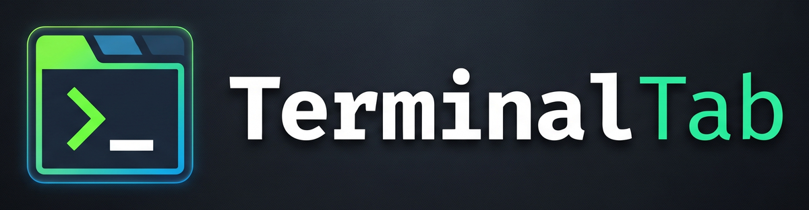

<p align="center"></p>

# TerminalTab

A Windows and Linux app for keeping many SSH sessions open side by side as tabs,
with your servers and `.pem` keys saved in an encrypted vault.

## Download

All installers are on the
[latest release](https://github.com/wouter075/TerminalTab/releases/latest) page.

### Windows

Download `TerminalTab-Setup.exe` and run it. It installs per user (no admin needed)
and adds a Start menu shortcut. The installer is not code-signed, so Windows
SmartScreen may warn the first time: choose *More info* → *Run anyway*. A portable
`.zip` is attached as well.

### Linux

64-bit (x86_64) packages for desktop Linux:

| Distribution | File |
| --- | --- |
| Ubuntu, Debian, Linux Mint, Pop!_OS, … | `terminaltab_<version>_amd64.deb` |
| Fedora, RHEL, Rocky / AlmaLinux, … | `terminaltab-<version>-1.x86_64.rpm` |

**Ubuntu / Debian.** Download the `.deb`, then in a terminal:

```sh
cd ~/Downloads
sudo apt install ./terminaltab_*_amd64.deb
```

Use `apt` (not `dpkg -i`) so the libraries it needs are installed too. To update,
install the newer `.deb` the same way.

**Fedora / RHEL.** Download the `.rpm`, then:

```sh
cd ~/Downloads
sudo dnf install ./terminaltab-*.x86_64.rpm
```

**Start it** from your app menu (*TerminalTab*) or run `terminaltab` in a terminal.

**Uninstall** with `sudo apt remove terminaltab` or `sudo dnf remove terminaltab`.
Your vault stays in `~/.config/TerminalTab/`; delete that folder to remove your saved
servers and keys as well.

Good to know:

- The app needs a graphical desktop (X11 or Wayland). It also runs in WSL on
  Windows 11.
- At install time the package makes Electron's `chrome-sandbox` helper setuid root,
  which Ubuntu 24.04 and later need for the sandbox to start. If the app quits right
  away, run `sudo chmod 4755 /usr/lib/terminaltab/chrome-sandbox`.
- Auto-lock on screen lock is Windows-only. On Linux the vault still locks after
  inactivity and when the PC goes to sleep.
- Moving from another PC? Use *Restore from GitHub* on the first start (see
  [Sync between PCs](#sync-between-pcs-github)).

## Features

- SSH sessions as tabs (xterm.js + ssh2, no OpenSSH install needed)
- Saved servers with groups, colors and search (Ctrl+T, Enter to connect)
- **Import** servers and their keys from `~/.ssh/config` (Host blocks, `Host *`
  defaults, `Include`) and from saved PuTTY sessions on Windows
- Import `.pem` / OpenSSH private keys (passphrase-protected keys supported); the key
  is copied into the vault, so the original file can be removed
- Optional saved password per server
- Everything encrypted with your master password (scrypt + AES-256-GCM)
- Host-key verification (trust on first use, warning when a key changes)
- **Files (SFTP)** side panel per tab (Ctrl+Shift+E): browse the server, drag files
  and folders from Explorer / your file manager to upload, download, rename, delete,
  new folder, and "cd here" to jump the terminal to a folder
- **Snippets**: saved commands, inserted into the current tab from the palette
  (Ctrl+Shift+P) or the right-click menu; optionally run straight away. They sync
  with your vault
- **Find** in the scrollback (Ctrl+F) with match case and regex
- **Auto-reconnect** when a connection drops (not after you type `exit`)
- **Colour schemes** (TerminalTab Dark, One Dark, Solarized Dark/Light, Gruvbox,
  Nord) and any installed font
- **Session logs** (optional): everything shown in a tab saved as plain text per server
- **Auto-update**: Windows installs new versions in the background and applies
  them on restart; Linux shows a notice with a download link
- Auto-lock after inactivity, on sleep and (Windows) on screen lock; open tabs keep running
  behind the lock screen but cannot receive input
- Right-click menu in the terminal: Copy, Paste, Select all, Find, Snippets, Files,
  Clear screen, Duplicate tab, Close tab (text fields get Cut / Copy / Paste)
- Status bar for the visible tab: connection, key, connected time, latency,
  server OS / CPU load / RAM / disk / uptime (Linux, can be turned off in
  Settings), terminal size and data sent/received

### Keyboard shortcuts

| Keys | Action |
| --- | --- |
| Ctrl+T | Search servers (Enter opens the first match) |
| Ctrl+Shift+P | Palette: insert a snippet or open a server |
| Ctrl+Shift+E | Show / hide the Files (SFTP) panel |
| Ctrl+F | Find in the terminal (Enter / Shift+Enter: next / previous) |
| Ctrl+Shift+C / Ctrl+Shift+V | Copy / paste (selecting text also copies) |
| Ctrl+W | Close tab (middle-click a tab works too) |
| Ctrl+Tab / Ctrl+Shift+Tab | Next / previous tab |

## Development

```sh
npm install
npm start          # run in development
npm test           # vault + SSH session tests (spins up a local test SSH server)
npm run typecheck
npm run make       # Windows: out/make/squirrel.windows/x64/TerminalTab-Setup.exe
                   # Linux:   out/make/deb/x64/*.deb and out/make/rpm/x64/*.rpm
                   #          (needs dpkg, fakeroot and rpmbuild)
```

Releases are built by GitHub Actions (`.github/workflows/release.yml`): bump
`version` in `package.json`, commit, then push a matching tag, e.g.
`git tag v1.0.1 && git push origin v1.0.1`.

The vault lives at `%APPDATA%\TerminalTab\vault.json` (Windows) or
`~/.config/TerminalTab/vault.json` (Linux). Forgetting the master
password means the vault cannot be decrypted. Delete the file to start over.

## Layout

| Path | What |
| --- | --- |
| `src/main/main.ts` | Electron window and app lifecycle |
| `src/main/vault.ts` | Encrypted vault (file format, unlock, save) |
| `src/main/sessions.ts` | SSH connections (one ssh2 client per tab), latency + traffic counters |
| `src/main/serverStats.ts` | Read-only stats script and its parser |
| `src/main/sftp.ts` | SFTP over the tab's connection: list, transfers with progress, rename, delete |
| `src/main/importers.ts`, `importScan.ts` | `~/.ssh/config` and PuTTY import |
| `src/main/sessionLog.ts` | Plain-text session logs |
| `src/main/updates.ts` | Auto-update (Squirrel via update.electronjs.org) and Linux release check |
| `src/main/sync.ts`, `merge.ts`, `github.ts` | GitHub sync: pull / merge / push of the encrypted vault |
| `src/main/ipc.ts` | IPC handlers, key import, host-key prompts, auto-lock |
| `src/preload.ts` | `window.terminalTab` bridge (the renderer has no Node access) |
| `src/shared/` | Types shared by main and renderer |
| `src/renderer/` | React UI |

Private keys and passwords stay in the main process. The renderer only gets
names and flags.

## Sync between PCs (GitHub)

TerminalTab can sync your servers, keys, snippets and trusted host keys through a **private**
GitHub repository. Only the encrypted vault file (`terminaltab-vault.json`) is
uploaded; GitHub never sees your data or your master password.

**First PC:** Settings → Sync with GitHub
1. Create a private repository, e.g. `terminaltab-vault`.
2. Create a [fine-grained token](https://github.com/settings/personal-access-tokens/new):
   *Only select repositories* → that repo, permission *Contents: Read and write*.
3. Enter the repo and token. The token is stored inside your encrypted vault.

**Other PCs:** on the first screen choose *Restore from GitHub* and enter the repo,
a token and your master password.

How it works:
- Syncs after unlocking, after every change, and every 5 minutes.
- Changes are merged per server/key (newest edit wins, deletions are kept), so
  edits on two PCs don't overwrite each other. Simultaneous saves are detected
  with GitHub's file version and retried.
- Every sync is a commit, so older versions can be restored from the repo history.
- If you change the master password on one PC, the others ask for the new one at
  their next sync and switch to it.
- Public repositories and read-only tokens are refused.
- Because the encrypted vault is online, use a long master password (the app
  warns if it is short).

## License

MIT, see [LICENSE](LICENSE).
